# 圆片缺陷识别算法讲解（halcon/DiscDefect.hdev）

> 2026-10-28 版。数据集：`data/station/` 的 12 张工位图（每类 3 张，来源见 `data/station/来源.md`）。

## 1. 结果先看

| 测试 | HALCON（本算法） | OpenCV 基线（比赛版 detector.py） |
|---|---|---|
| 工位图 12 张 | **12/12**，平均 43 ms | 11/12（H_1 误判为 Q），平均 446 ms |
| 稳健性测试 12 × 8 种变换 | **96/96** | — |
| 旧比赛图 data/samples（只记录） | 10/11 | 11/11 |
| 合成图 data/synthetic（只记录） | 11/13 | 10/13 |
| 上位机仿真闭环 12 件 | 12/12，单件总耗时平均 61 ms | — |

稳健性测试的 8 种变换：原图、旋转 90°/180°/30°、左右镜像、缩小到 0.8 倍、整体变暗到 0.85、加白噪声。

| Q 缺角 | H 划痕 | K 孔洞 | W 污渍 |
|---|---|---|---|
| 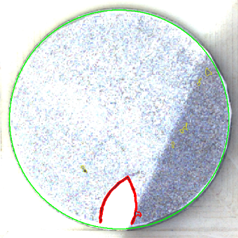 | 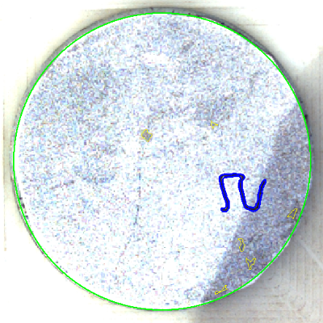 | 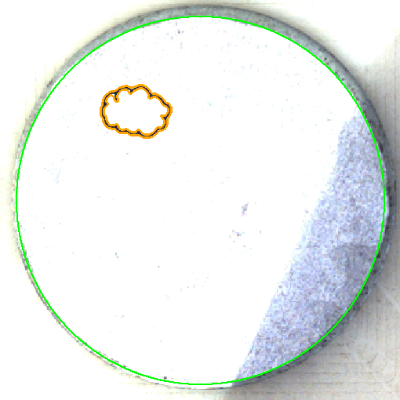 | 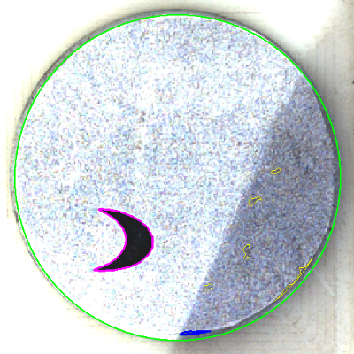 |

绿色 = 找到的圆片边缘，彩色粗线 = 缺陷（Q 红、H 蓝、K 橙、W 紫），黄色细线 = 没被判为缺陷的候选。

## 2. 图像有什么特点（为什么这样设计）

- 白色治具上放着金属圆片，圆片表面印着彩色细噪点，外圈有一道 5～10 px 的暗色斜边。
- **严重过曝**：圆片表面和治具大部分都是 255，只有斜边和阴影处有灰度变化。所以找圆要找"表面 → 暗边"的分界。
- **右侧有一块斜的蓝紫色阴影**：阴影区灰度只有 150～200，噪点也更明显。分割时必须用"局部背景"作比较，不能用固定阈值。
- **缺陷都是纯黑墨迹**：对比度在 90 以上。线宽 2～4 px，实心块厚 15 px 以上。
- **四类的区别在形状拓扑上，不在灰度上**：

| 类别 | 形状 | 用什么特征区分 |
|---|---|---|
| Q 缺角 | 线条两端碰到圆边，和圆边围出一个"角" | 离边距离 + 切角面积 |
| K 孔洞 | 闭合的空心轮廓 | 孔比例 |
| W 污渍 | 实心的厚块 | 厚度（最大内切圆半径） |
| H 划痕 | 不碰边、不闭合的细线 | 长度（骨架长度） |

## 3. 整体流程

```
dd_detect
 ├─ dd_locate_disk   找圆：圆弧 → 候选圆 → metrology 打分选最优
 ├─ dd_segment       分割：V 通道 → 平滑 → 局部背景 → 双阈值 → 闭运算 → 连通域
 └─ 对每个候选：
     ├─ dd_region_features  算 7 个特征
     └─ dd_classify_region  按 对比度 → Q → K → W → H 的顺序判定
    主缺陷 = 面积 × 对比度最大的那个，它的类别就是整张图的类别
```

辅助过程：`dd_to_gray`（转灰度）、`dd_make_roi`（检测区域）。`augment_image`、`write_feature_rows`、`draw_result` 只给 main 批量测试用，上位机不调用。

## 4. 第 1 步：转灰度（dd_to_gray）

取 R、G、B 三个通道中的最大值（`access_channel` + `max_image`），等于 HSV 的 V 通道。

| 普通灰度 `rgb1_to_gray` | V 通道（本算法） |
|---|---|
| 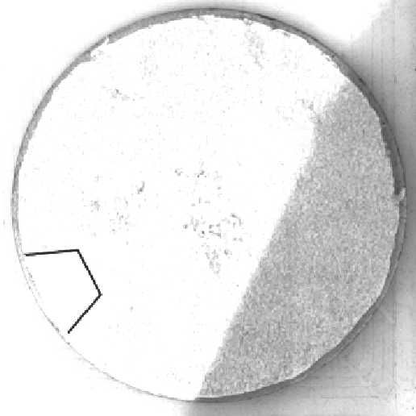 | 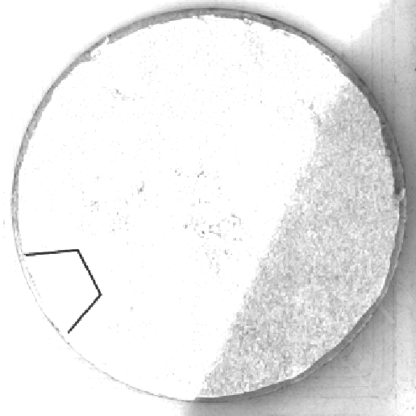 |

肉眼看差别不大，但对照实验说明了问题。把 `dd_to_gray` 换成普通灰度、其余都不变，96 张也全对，可是 Q_3（花瓣紧挨着阴影）的线条和阴影噪点粘到了一起：

| 灰度方案 | 面积 | 厚度 |
|---|---|---|
| 普通灰度 | 约 1690 px | 0.05R，正好碰到 W 的阈值 |
| V 通道 | 约 1110 px | 0.017R |

原因是阴影偏蓝，B 通道仍然亮，取最大值后阴影变浅；黑墨迹三个通道都暗，不受影响。

## 5. 第 2 步：找圆（dd_locate_disk）

### 5.1 粗定位：从圆弧得到候选圆

| 算子 | 作用 |
|---|---|
| `edges_sub_pix (Gray, Edges, 'canny', 2, 20, 40)` | 亚像素边缘，Canny 高阈值 `edge_amplitude`=40，低阈值取一半 |
| `segment_contours_xld (..., 'lines_circles', 5, 4, 2)` | 把边缘切成直线段和圆弧段 |
| `select_contours_xld (..., 'contour_length', 40, ...)` | 只留长度 40 px 以上的段 |
| `get_contour_global_attrib_xld (..., 'cont_approx', Approx)` | Approx = 1 表示这段是圆弧 |
| `fit_circle_contour_xld` | 每段圆弧拟合一个圆；半径在 [0.2, 0.5] × 图像短边范围内的作为候选圆 |

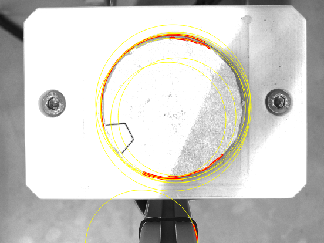

红色 = 圆弧段，黄色 = 拟合出的候选圆（Q_1 有 8 个）。只靠这一步选不准：螺钉、治具的弧也会给出候选圆。

### 5.2 精定位：metrology 给每个候选圆打分

| 算子 | 作用 |
|---|---|
| `create_metrology_model` / `set_metrology_model_image_size` | 建测量模型 |
| `add_metrology_object_circle_measure (..., 20, 4, 1.5, 20, ['measure_transition','measure_select','num_measures','min_score'], ['negative','first',180,0.3], ...)` | 每个候选圆放 180 条测量线，每条长 ±20 px，方向由圆心向外，找**第一个由亮变暗**的边缘（表面 → 暗边） |
| `apply_metrology_model` | 测量，并用 RANSAC 拟合圆 |
| `get_metrology_object_result (..., 'all_param')` / `(..., 'score')` | 取圆参数和得分 |

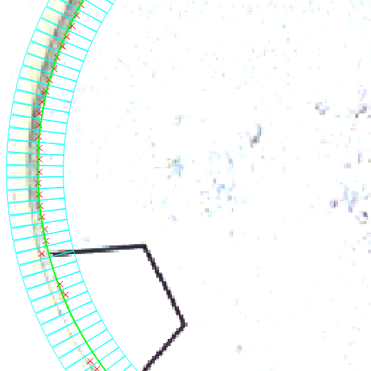

青色框 = 测量线，红叉 = 测到的边缘点，绿色 = 拟合结果。

**得分** = 参与拟合的测量点占测量线的比例。真正的圆片边缘几乎整圈都能测到，所以得分最高（Q_1 为 0.70）。得分低于 `circle_min_score`=0.4 判为没找到圆，整张图输出 NONE。

**为什么不用自己写的"边缘支持率"**：最早的版本就是自己算支持率，图像变暗 15% 或加噪声后，有 3 张图找不到圆。改成 metrology 打分后全部能找到。

## 6. 第 3 步：分割墨迹（dd_segment）

| 步骤 | 算子 | 参数 |
|---|---|---|
| 检测区域 | `erosion_circle (Disk, Roi, 0.04R)`（在 `dd_make_roi` 里） | 避开边缘暗边 |
| 平滑 | `smooth_image (Gray, Smoothed, 'gauss', 1.5)` | `smooth_sigma` |
| 局部背景 | `mean_image (Smoothed, Background, 0.5R, 0.5R)` | `background_kernel_ratio` |
| 暗度 | `sub_image (Background, Smoothed, Darkness, 1, 0)` | 每个像素比背景暗多少 |
| 双阈值 | `hysteresis_threshold (Darkness, RawRegion, 40, 50, 50)` | `dyn_threshold_low` / `dyn_threshold_offset` |
| 接断线 | `closing_circle (..., 3.5)` | `closing_radius` |
| 拆分、去小块 | `connection` + `select_shape ('area', 60, ...)` | `min_component_area` |

| 局部背景（均值滤波） | 暗度图（×2 显示） | 分割结果 |
|---|---|---|
|  | 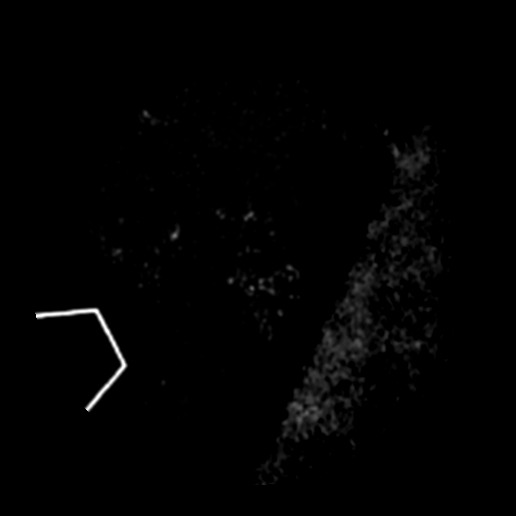 | 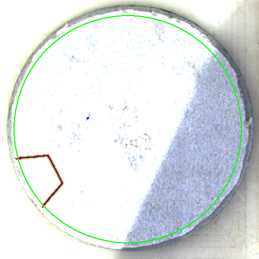 |

要点：

- **局部背景**：窗口取 0.5R（约 120 px），比最大的污渍（约 90 px）还宽。窗口太小的话，污渍中间的背景也是黑的，中间就会漏检，实心块变成空心圈，被误判成 K。
- **双阈值**（原理和 Canny 一样）：暗度 ≥ 50 的像素一定是墨迹（种子），暗度 ≥ 40、并且和种子连着的像素也算墨迹。
  - 只用单阈值 50 时，Q_3 缩小 0.8 倍后，花瓣右边的线在穿过阴影边界处变淡，断成两段，围不出"角"，被误判为 H。
  - 低阈值试过 25、35、40、50：40 全对，噪声也最少。

## 7. 第 4 步：特征（dd_region_features）

| 特征（Result 的键） | 计算 | 含义 |
|---|---|---|
| `area` 面积 | `area_center` | 像素数 |
| `contrast` 对比度 | 外扩 5 px 的一圈背景平均灰度 − 区域平均灰度（`dilation_circle` + `difference` + `intensity`） | 越大越黑 |
| `edge_gap` 离边距离 | R − 区域离圆心的最远距离（`distance_pr`） | 越小越靠近边 |
| `pocket_area` 切角面积 | 见下图 | Q 专用 |
| `hole_ratio` 孔比例 | 孔面积 / (面积 + 孔面积)（`area_holes`） | 闭合轮廓接近 1，其余接近 0 |
| `thickness` 厚度 | 最大内切圆半径（`inner_circle`） | 线条 1～4 px，实心块十几像素 |
| `length` 长度 | 骨架像素数（`skeleton`） | 细线的长度 |
| `score` 得分 | 面积 × 对比度 | 选主缺陷 |

**切角面积怎么算**：
1. 取一个比圆片小"碰边容差"（0.08R）的测试圆（黄色）；
2. 减去线条（稍微加粗 1.5 px，防止斜线漏缝），再 `connection`；
3. 最大的一块（灰色）是圆片主体，其余碰到测试圆边界的块（红色）就是被线条和圆边围起来的"角"。

测试圆比圆片小一圈的原因：工位图上 Q 线的末端离圆边还有 5～10 px，用测试圆才能把角"封住"。闭合轮廓（K）中间那块碰不到测试圆边界，所以不算角。

| Q 的切角 | K 的孔（橙色） | W 的最大内切圆 | H 的骨架（红线） |
|---|---|---|---|
| 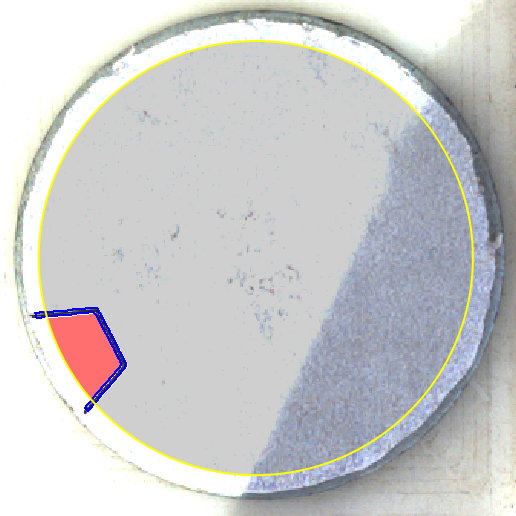 | 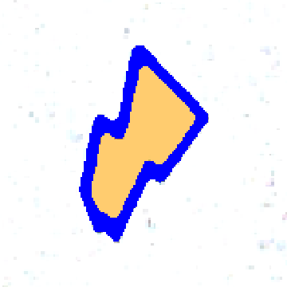 | 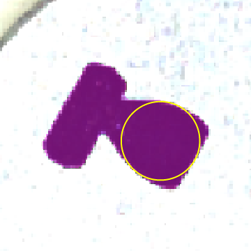 | 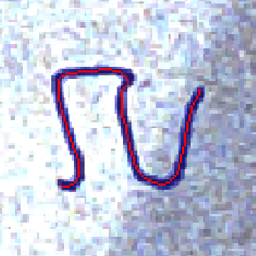 |

## 8. 第 5 步：分类（dd_classify_region）

按顺序判断，先满足的先定：

```
对比度 < 60                                   → 不是缺陷（阴影污点、噪点）
离边距离 ≤ 0.08R  且  切角面积 ≥ 0.003·πR²     → Q
孔比例 ≥ 0.3                                  → K
厚度 ≥ 0.05R                                  → W
长度 ≥ 0.1R                                   → H
都不满足                                      → 不是缺陷
```

**顺序为什么这样排**：
- Q 最先，因为缺角的线条本身也是细线，放在 H 后面就会被当成 H。
- K 在 W 前，因为闭合轮廓的拐角处可能偏厚。
- H 最后兜底。

**阈值怎么来的**：下表是 96 张变换图里主缺陷特征的范围（都按半径 R 归一化），阈值取在两类的间隔中间。

| 特征 | 本类 | 其他类 | 阈值 |
|---|---|---|---|
| 离边距离 / R | Q：0.035～0.044 | 非 Q：≥ 0.179 | 0.08 |
| 切角面积 / πR² | Q：0.018～0.028 | 非 Q：0 | 0.003 |
| 孔比例 | K：0.53～0.71 | 非 K：0 | 0.3 |
| 厚度 / R | W：0.075～0.096 | H、K：≤ 0.031 | 0.05 |
| 长度 / R | H：0.54～0.82 | — | 0.1 |
| 对比度 | 缺陷：99～208 | 噪点：≤ 79 | 60 |

几何阈值都按 R 的比例给出，所以换相机、分辨率变了也不用重调。缩小 0.8 倍的测试就是在验证这一点。

**主缺陷**：一张图可能有多个候选被判为缺陷，例如边缘残留的暗弧、阴影里的污点。得分（面积 × 对比度）最高的是主缺陷，它决定整张图的类别。96 张图里，其他候选的得分最多只有主缺陷的 3%。

## 9. 全部参数

在 `dd_default_params` 里定义。上位机"视觉调试"页可以调，中文名和范围在 `halcon/detector_meta.json`，点"保存"写入 `halcon/detector.json`。

| 键 | 默认 | 作用 |
|---|---|---|
| radius_min_ratio / radius_max_ratio | 0.2 / 0.5 | 圆半径搜索范围（× 图像短边） |
| edge_amplitude | 40 | 粗定位 Canny 高阈值 |
| circle_min_score | 0.4 | metrology 最低得分 |
| metrology_measure_length / metrology_threshold | 20 / 20 | 测量线半长、边缘最小跳变 |
| rim_margin_ratio | 0.04 | 检测区域向内收缩（× R） |
| smooth_sigma | 1.5 | 高斯平滑 |
| background_kernel_ratio | 0.5 | 背景窗口（× R） |
| dyn_threshold_offset / dyn_threshold_low | 50 / 40 | 双阈值 |
| closing_radius | 3.5 | 闭运算 |
| min_component_area | 60 | 最小候选面积 |
| min_defect_contrast | 60 | 最小缺陷对比度 |
| q_contact_ratio / q_min_pocket_ratio | 0.08 / 0.003 | Q |
| k_min_hole_ratio | 0.3 | K |
| w_min_thickness_ratio | 0.05 | W |
| h_min_length_ratio | 0.1 | H |

## 10. 怎么运行、怎么验证

- **HDevelop 里**：打开 `halcon/DiscDefect.hdev` 按 F5。main 会把 `data/station` 全部跑一遍，生成：
  - `output/halcon_station.csv`：每张图一行；
  - `output/halcon_station_features.csv`：每个缺陷一行；
  - `output/halcon_station/`：效果图。

  变量窗口里的 `Summary` 显示正确数。
- **稳健性测试**：把 main 里的 `AugList` 改成注释里那 8 项再运行，结果写到 `output/halcon_station_robust*`。
- **命令行**：`hrun -b halcon/DiscDefect.hdev`
- **和 OpenCV 对比**：
  ```
  python tools/opencv_baseline.py --images data/station --out output/opencv_station.csv
  python tools/compare.py output/opencv_station.csv output/halcon_station.csv --report output/station_report.md
  ```
- **上位机回归测试**：`dotnet test`，其中 `AlgorithmTests` 用 HDevEngine 跑 12 张工位图，必须全对。改了 .hdev 或参数之后跑一遍。

## 11. 已知局限

- **样本少**：每类只有 3 张，阈值是按这 12 张定的。实验室采到新图后，放进 `data/station`（文件名按 `类别_序号` 命名），再跑一遍回归。
- **没有合格件样本**：工位图都有缺陷，所以"无缺陷 → NONE"只在合成图上验证过。`min_defect_contrast` 等合格件采到后再确认。
- **Q 的定义**：要求线条和圆边围出一个角。单侧碰边的缺口（合成图 `Q_single_contact_notch`）和径向直线（`NONE_radial_line`）都会判成 W，这两张是比赛旧规则下的样例，和工位图的画法不同。
- **旧比赛图**：W_1.jpg 找不到圆。那批图是手持拍摄，圆片边缘对比度很低，不在本次目标范围内。
