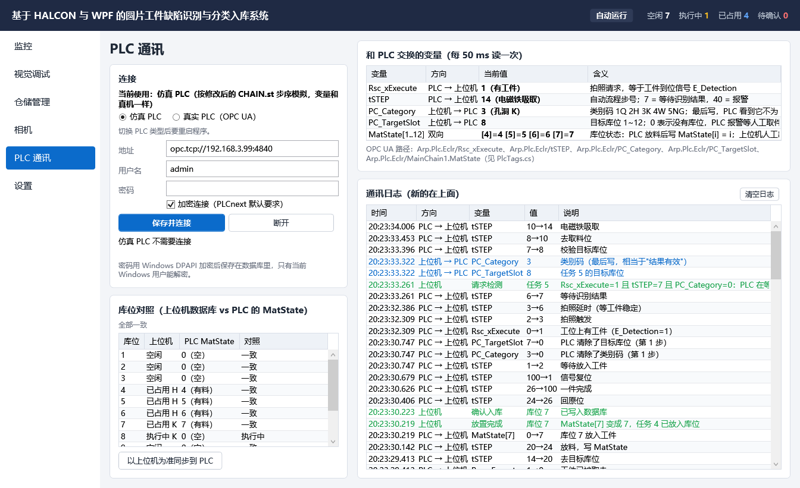

# 上位机与 PLC 的交互说明

> 这份文档回答两个问题：**以前（比赛版）是怎么和 PLC 交互的**，**现在识别结果怎么传给 PLC、怎么放到对应库位**。
> 对应代码：`src/DiscSorter.Core/Plc/`（StationPlcBase、OpcUaPlc、SimulatedPlc、PlcTags）。PLC 一侧的改法见 `plc/PLC程序修改说明.md`。

## 1. 以前的系统（比赛版）

### 1.1 结构

```
 ┌──────────────── EPC 1502（PLCnext，Linux）────────────────┐
 │  容器 edge-defect-app（Python）        PLC 程序（ST）        │
 │   app.py 每 10 ms 读 Rsc_xExecute ◀── CHAIN.st             │
 │   hik_camera.py 抓图（MVS SDK）        imageClassify        │
 │   detector.py OpenCV 识别                                   │
 │   写 imageClassify.image_result ──▶   第 7 步读 Camera.Data │
 │   （PyPlcnextRsc，RSC 协议）           第 8 步自己定库位     │
 └────────────────────────────────────────────────────────────┘
```

Python 程序和 PLC 程序跑在同一台 EPC 上，通过菲尼克斯的 RSC 接口（PyPlcnextRsc 库）直接读写 PLC 变量。

### 1.2 一件工件的流程

| PLC 步号 | PLC 做什么 | Python 做什么 |
|---|---|---|
| 2 | 等 `E_Detection`（工件到位） | |
| 末尾每周期 | `Rsc_xExecute := E_Detection` | 每 10 ms 读 `Rsc_xExecute`，看到 1 就拍照、识别 |
| 3 → 6 | 拍照延时 0.8 s | 识别完写 `imageClassify.image_result.index`：Q=1、H=2、K=3、W=4、多类=5 |
| 7 | `imageClassify` 程序把 `image_result.index` 抄到 `Camera.Data`；第 7 步看到 `Camera.Data > 0` 就把它存进 `iType`。5 s 没结果就回第 1 步 | |
| **8** | **按类别写死分列**：K → 库位 1~3，H → 4~6，W → 7~9，Q → 10~12。每列按顺序找第一个 `MatState[i] <> i` 的库位，记为 `Pos`。整列都满了，或类别是 5，就跳到第 40 步报警 | |
| 10~16 | 三轴到取料位，电磁铁吸取，抬起 | |
| 20~23 | 按 `ServoPos[轴][Pos]` 移动到库位 | |
| **24** | 电磁铁松开，**`MatState[Pos] := Pos`**（记下这个库位有料） | |
| 25~26 → 100 | 回原位，一件结束 | |

库位坐标在全局变量 `ServoPos` 里。X 轴决定列：4600、-2000、-8600、-15200 分别对应列 1～4；Z 轴决定行（5600、-6500、-18500）。所以库位号 = (列 − 1) × 3 + 行，和上位机的编号完全一致。

### 1.3 旧方式的问题

- 分列写死在 PLC 程序里，想换"哪类放哪列"必须改 PLC 程序。
- 视觉程序只知道类别，**不知道放到了哪个库位**，没有入库记录，也没法统计。
- 库位状态只在 PLC 的 `MatState` 里（掉电保持）。人工取走以后，要在 HMI 上清，否则 PLC 一直认为库位满。
- 库满和"识别错误"都进第 40 步，提示一样，分不清。

## 2. 现在的系统

### 2.1 结构

```
 ┌──────────── Windows 上位机（DiscSorter）────────────┐          ┌──── EPC 1502 ────┐
 │ 相机页：HikCamera（MVS SDK）── GigE ──▶ 海康相机      │          │                  │
 │ HalconDetector（HDevEngine 调 DiscDefect.hdev）      │          │ CHAIN.st（改 4 处）│
 │ WarehouseService（SQLite）：列映射、分配库位、记录     │  OPC UA  │  第 7 步等结果    │
 │ SortingCoordinator：握手流程 ◀──▶ OpcUaPlc ─────────┼─────────▶│  第 8 步用上位机   │
 │ PLC 通讯页：变量表、库位对照、通讯日志                 │ 4840 端口 │  给的库位         │
 └──────────────────────────────────────────────────────┘          └──────────────────┘
```

变化：识别和库位分配都搬到上位机，PLC 只负责搬运。通信从 RSC 换成标准的 OPC UA，C# 有官方库，论文里也更好写。

### 2.2 交换的变量（5 个）

| 变量 | OPC UA 路径 | 类型 | 方向 | 含义 |
|---|---|---|---|---|
| `Rsc_xExecute` | `Arp.Plc.Eclr/Rsc_xExecute` | BOOL | PLC → 上位机 | 工位上有工件（= `E_Detection`） |
| `tSTEP` | `Arp.Plc.Eclr/tSTEP` | INT | PLC → 上位机 | 自动流程步号 |
| `PC_Category` | `Arp.Plc.Eclr/MainChain1.PC_Category` | INT | 上位机 → PLC | 类别码 1Q 2H 3K 4W 5NG，**最后写**；0 = 无结果（第 1 步 PLC 清 0） |
| `PC_TargetSlot` | `Arp.Plc.Eclr/MainChain1.PC_TargetSlot` | INT | 上位机 → PLC | 目标库位 1~12；0 = 没有可用库位 |
| `MatState` | `Arp.Plc.Eclr/MainChain1.MatState` | ARRAY[0..12] OF INT | 双向 | `MatState[i] = i` 表示库位 i 有料。PLC 放料后写；上位机人工出库后写 0 |

上位机每 50 ms 用**一次** OPC UA Read 读这 5 个变量，写的时候一次写一个。

### 2.3 一件工件的时序

下面是"PLC 通讯"页通讯日志里真实记录的一件工件（仿真 PLC 和真实 PLC 的日志格式一样）：

```
时间          方向           变量            值      说明
20:23:32.309  PLC → 上位机   Rsc_xExecute   0→1     工位上有工件（E_Detection=1）
20:23:32.309  PLC → 上位机   tSTEP          2→3     拍照触发
20:23:32.386  PLC → 上位机   tSTEP          3→6     拍照延时（等工件稳定）
20:23:33.261  PLC → 上位机   tSTEP          6→7     等待识别结果
20:23:33.261  上位机         请求检测       任务 5   Rsc_xExecute=1 且 tSTEP=7 且 PC_Category=0
              （上位机：相机拍照 → HALCON 识别为 K → 查列映射 K 在列 3 → 列 3 第一个空位是库位 8 → 预留）
20:23:33.322  上位机 → PLC   PC_TargetSlot  8       任务 5 的目标库位
20:23:33.322  上位机 → PLC   PC_Category    3       类别码（最后写，相当于"结果有效"）
20:23:33.396  PLC → 上位机   tSTEP          7→8     校验目标库位（MatState[8] ≠ 8，可以放）
20:23:33.453  PLC → 上位机   tSTEP          8→10    去取料位
   ……                                               取料、Rsc_xExecute 1→0（工件被吸走）、去库位
xx:xx:xx.xxx  PLC → 上位机   tSTEP          20→24   放料，写 MatState
xx:xx:xx.xxx  PLC → 上位机   MatState[8]    0→8     库位 8 放入工件
xx:xx:xx.xxx  上位机         放置完成       库位 8   MatState[8] 变成 8，任务 5 已放入库位
xx:xx:xx.xxx  上位机         确认入库       库位 8   已写入数据库（库位 8：执行中 → 已占用）
xx:xx:xx.xxx  PLC → 上位机   tSTEP          26→100  一件完成
xx:xx:xx.xxx  PLC → 上位机   PC_Category    3→0     PLC 清除了类别码（第 1 步）
```



### 2.4 结果怎么传到对应库位

1. **类别 → 列**：仓储管理页给 4 列各选一个类别（默认 列 1=Q、列 2=H、列 3=K、列 4=W），存在数据库的 `ColumnMappings` 表里。这一步就是任务书说的"能指定缺陷类别放在哪列"，PLC 程序不用改。
2. **列 → 库位**：`WarehouseService.Reserve()` 在这一列里找行号最小的空闲库位，标为"执行中"。库位号 = (列 − 1) × 3 + 行。这一列满了，或这个类别没有分配列（例如 NG），就给 0。
3. **写给 PLC**：先写 `PC_TargetSlot`，再写 `PC_Category`。顺序很重要：PLC 第 7 步一看到类别码不为 0，第 8 步马上就会去读库位。如果先写类别，PLC 可能读到上一件的库位。
4. **PLC 搬运**：第 8 步检查库位在 1~12 范围内，并且 `MatState[库位]` 不等于库位号（空着），然后 `Pos := PC_TargetSlot`，按 `ServoPos[轴][Pos]` 搬过去，第 24 步写 `MatState[Pos] := Pos`。
5. **上位机确认**：看到 `MatState[库位]` 由别的值变成库位号，就调用 `WarehouseService.Complete()`，把库位从"执行中"改成"已占用"，并写入任务记录。

### 2.5 上位机怎么把 PLC 变量换算成握手信号

分拣协调器（`SortingCoordinator`）只认几个"握手信号"，由 `StationPlcBase` 根据这 5 个变量算出来。所以仿真 PLC 和真实 PLC 共用同一套流程代码：

| 握手信号 | 怎么算 |
|---|---|
| 请求检测 InspectRequest | `Rsc_xExecute = 1` 且 `tSTEP = 7` 且 `PC_Category = 0` |
| 任务号 JobId | 上位机自己数：请求检测每出现一次就加 1（旧 PLC 程序没有任务号） |
| 写结果 WriteResult | 先写 `PC_TargetSlot`，最后写 `PC_Category` |
| 放置完成 SortDone、DoneSlot | 写结果以后，`MatState[i]` 新变成 `i`。如果变的不是目标库位，就是放错了，库位标为"待确认" |
| 报警码 ErrCode | `tSTEP = 40` 时：给的库位是 0 → 报警 5（无可用库位，需人工取件）；否则 → 报警 4（库位非法或已占用） |

### 2.6 异常情况

| 情况 | PLC 怎么做 | 上位机怎么做 |
|---|---|---|
| 该类别的列满了 / 类别没有分配列 | 收到库位 0，进第 40 步报警，等人工取件、按复位 | 写库位 0，记录"目标库位 0（人工取件）"，监控页显示报警 5 |
| 上位机给的库位 PLC 记为有料 | 进第 40 步 | 报警 4，监控页提示；到"PLC 通讯"页看库位对照 |
| 上位机 5 秒没给结果（未联机、程序没开） | 回第 1 步，工件还在，于是重新请求 | 联机后会收到新的请求检测 |
| 搬运中卡住，迟迟不放料 | （PLC 自己的步超时报警） | 60 s 没看到 MatState 变化 → 库位标为"待确认" |
| 放错库位 | 写了别的 MatState | 库位标为"待确认"，在仓储页人工确认 |
| 人工取走库位里的工件 | — | 仓储页点"出库"后，自动把 `MatState[库位]` 写 0（以数据库为准同步） |
| 程序重启时有"执行中"的库位 | — | 自动变成"待确认"，人工确认后同步给 PLC |
| OPC UA 断线 | — | 读失败就断开，顶栏显示"PLC 未连接"，到"PLC 通讯"页重新连接 |

### 2.7 与计划书"完整握手方案"的关系

《毕设实施计划书》5.3 节设计的是更完整的 `PC_IF / PLC_IF` 接口，包括心跳、任务号、完成确认和出库命令。现在的方案只在 PLC 里加 2 个变量、改 4 处，就实现了"上位机决定库位"。以后要做得更完整，只需要：
- PLC 一侧按 5.3 节加变量；
- 上位机一侧在 `StationPlcBase` 里改换算规则。

分拣协调器和界面都不用动。

## 3. 没有 PLC 时怎么演示

"PLC 通讯"页选"仿真 PLC"（默认）。`SimulatedPlc` 按**修改后的 CHAIN.st 的步号**模拟（1 → 2 → 3 → 6 → 7 → 8 → 10 → 14 → 20 → 24 → 26 → 100），用的是同样的 5 个变量。所以通讯日志、变量表、库位对照和真机看起来一样，答辩现场没有硬件也能演示完整的交互过程。

仿真 PLC 的 `MatState` 在程序启动时按数据库里"已占用"的库位初始化，相当于真 PLC 的掉电保持。
