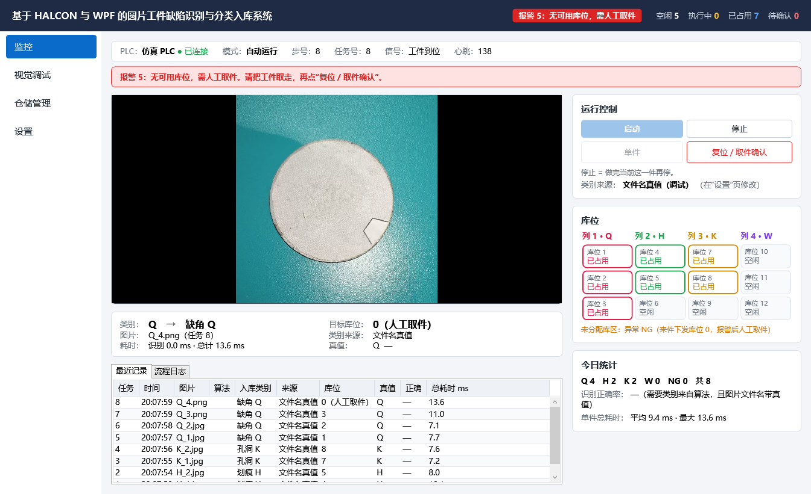
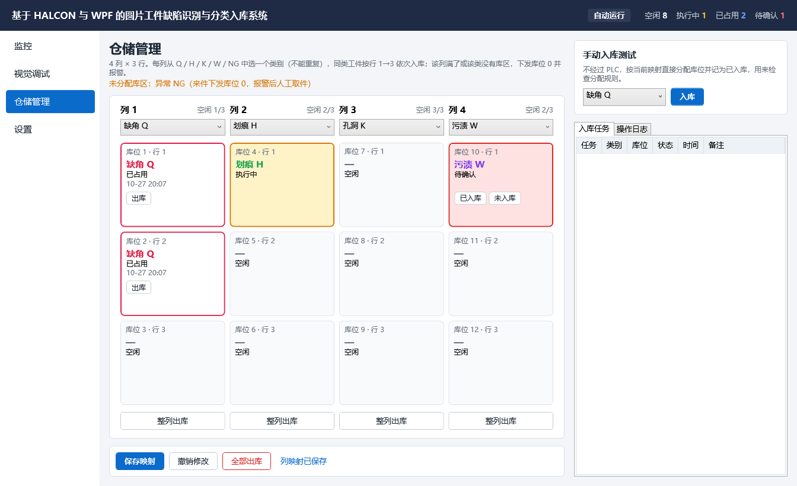
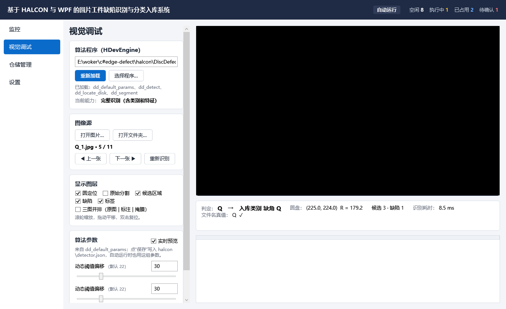
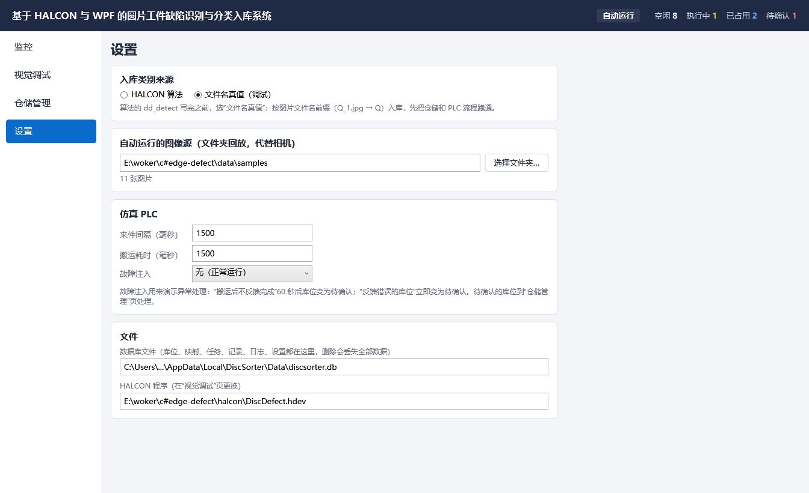
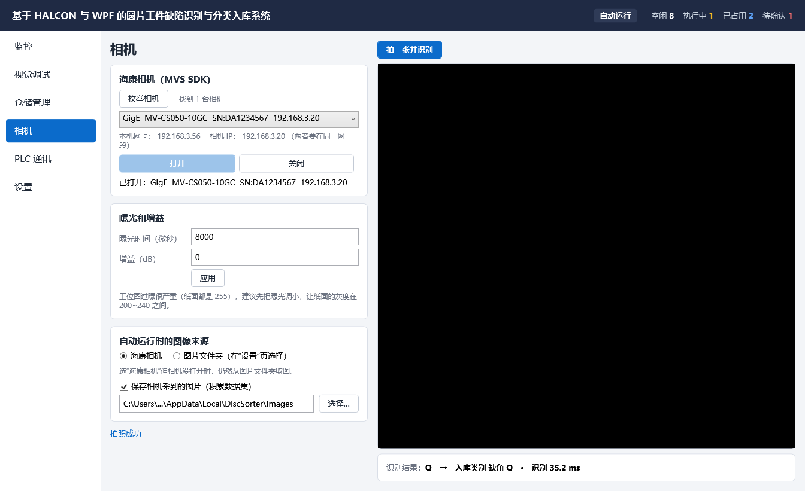
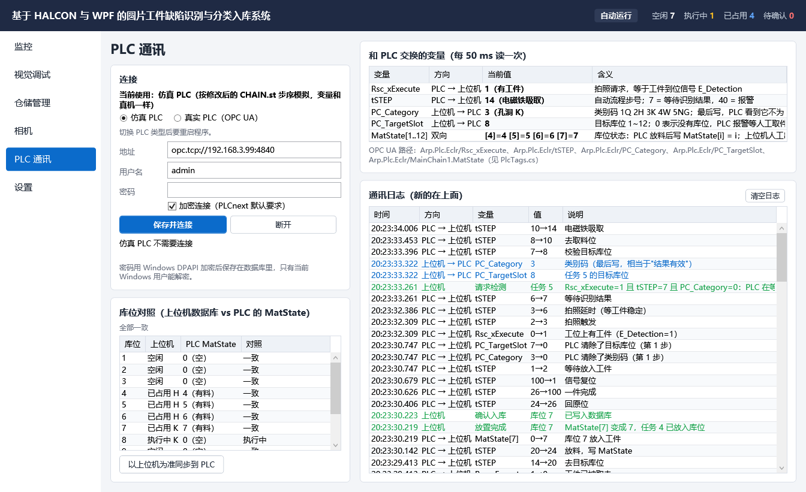

# 上位机代码导读

> 适用于 `DiscSorter.sln`（2026-10-27 按"教材写法"重写后的版本）。

## 1. 怎么打开、运行

1. 用 Visual Studio 打开 `E:\woker\c#edge-defect\DiscSorter.sln`。
2. 确认工具栏上的启动项目是 **DiscSorter.App**。如果不是：在解决方案资源管理器里右键 DiscSorter.App →"设为启动项目"。
3. 按 F5 运行。

第一次运行会在 `%LOCALAPPDATA%\DiscSorter\Data\discsorter.db` 自动建数据库，设置页里能看到完整路径。

运行测试：菜单"测试 → 运行所有测试"，或者在命令行执行 `dotnet test DiscSorter.sln`，共 64 个测试（其中 `AlgorithmTests` 用真实算法回归 12 张工位图，`CameraTests` 需要本机装有海康 MVS）。

## 2. 界面

| 监控 | 仓储管理 |
|---|---|
|  |  |

| 视觉调试 | 设置 |
|---|---|
|  |  |

| 相机 | PLC 通讯 |
|---|---|
|  |  |

- **相机页**：枚举局域网里的海康相机，打开、调曝光和增益，拍一张并识别；选择自动运行时的图像来源（相机或图片文件夹）。
- **PLC 通讯页**：选择仿真 PLC 或真实 PLC（OPC UA），填写连接参数；实时显示和 PLC 交换的 5 个变量、库位对照（上位机 vs PLC 的 MatState）和通讯日志。交互原理见 [PLC交互说明.md](PLC交互说明.md)。

## 3. 在设计器里预览和修改界面

每个页面都可以在 VS 的 XAML 设计器里直接看到效果：

1. 先**生成一次解决方案**（Ctrl+Shift+B）。设计器要用到编译好的 ViewModel，没有生成过它就显示不了。
2. 双击打开 `Views\WarehouseView.xaml`，设计器里会显示带示例数据的库位图（几个已占用、一个执行中、一个待确认）。
3. 改布局：直接改 XAML（每个属性单独一行，很好找），或者在设计器里选中控件，到"属性"窗口改。

**示例数据从哪来**：每个 XAML 文件开头有这么一行：

```xml
d:DataContext="{d:DesignInstance Type=vm:WarehouseViewModel, IsDesignTimeCreatable=True}"
```

它让设计器调用 `WarehouseViewModel` 的**无参构造函数**，构造函数里填的就是示例数据。`d:` 开头的属性只在设计器里起作用，程序运行时会被忽略，运行时用的是有参构造函数（连数据库的那个）。

**改颜色**：所有颜色都在 `Styles\Styles.xaml` 第 1 部分。例如把 `QBrush` 的 `Color` 改掉，库位卡片、文字、图上的缺陷框都会跟着变。

**图像区**：设计器里只显示"图像显示区（运行时显示 HALCON 图像）"这几个字。HALCON 窗口只在程序运行时才创建，所以设计器不会因为 HALCON 报错。

**12 个库位怎么摆的**：`WarehouseView.xaml` 里库位图是一个 5 行 × 4 列的 Grid，12 个 `SlotCard` 直接写死在格子里：

```xml
<controls:SlotCard Grid.Row="1" Grid.Column="0" Margin="4" DataContext="{Binding Slots[0]}"/>
```

意思是：放在第 1 行第 0 列，显示 `Slots[0]`（库位 1）。想调整某个库位的位置或大小，直接改这一行就行。

## 4. 项目结构

```
DiscSorter.sln
├─ src\DiscSorter.App           界面（WPF）
│   ├─ Styles\Styles.xaml       全部颜色和样式
│   ├─ MainWindow.xaml          主窗口：顶栏 + 左侧 4 个页签
│   ├─ Views\                   6 个页面：MonitorView、VisionView、WarehouseView、CameraView、PlcView、SettingsView
│   ├─ Controls\                自定义控件：SlotCard（库位卡片）、SlotCell（小格子）、DetectionViewer（HALCON 图像）
│   ├─ ViewModels\              每个页面一个 ViewModel，再加 SlotViewModel、ColumnViewModel 等
│   ├─ Converters\              类别 → 颜色、bool 取反
│   ├─ Helpers\                 命令行参数、截图
│   └─ App.xaml.cs              程序入口：创建所有对象，启动 50 ms 定时器
├─ src\DiscSorter.Core          业务逻辑（不含界面）
│   ├─ Models\                  数据类：类别、库位、任务、记录……
│   ├─ Data\                    数据库：建库升级、仓储服务、记录服务、设置
│   ├─ Vision\                  HALCON：调用 .hdev 过程、识别结果、参数；图像来源：图片文件夹、海康相机（HikCamera）
│   ├─ Plc\                     PLC：接口、共用握手逻辑（StationPlcBase）、仿真 PLC、真实 PLC（OpcUaPlc）、变量路径（PlcTags）
│   ├─ Common\                  工程路径、密码加密（SecretProtector）
│   └─ Workflow\                分拣协调器（上位机一侧的握手流程）
├─ tests\DiscSorter.Tests       单元测试
├─ lib\MVS\                     海康 MVS SDK 的 .NET 接口（MvCameraControl.Net.dll）
├─ halcon\                      识别算法 DiscDefect.hdev、参数说明
└─ plc\                         PLC 程序修改：CHAIN_修改后.st、CHAIN_原版.st、修改说明
```

**为什么分成两个项目**：Core 里没有任何界面代码，只有数据和规则，可以单独测试。App 只负责显示，以及把按钮操作交给 Core。论文画系统架构图时，就是"界面层 → 业务层 → 数据层 / 设备层"。

## 5. 程序是怎么跑起来的

`App.xaml.cs` 的 `OnStartup` 按顺序做这些事：

```
建数据库（DatabaseInitializer）
  → 创建服务：WarehouseService、RecordService、SettingsService
  → 按设置选 PLC：SimulatedPlc（仿真）或 OpcUaPlc（真实 PLC）
  → 创建 HalconDetector、HikCamera、SortingCoordinator
  → 创建 6 个页面的 ViewModel，交给 MainViewModel（相机页会按上次的序列号自动打开相机）
  → 真实 PLC：自动连接一次
  → 显示 MainWindow
  → 启动定时器（每 50 ms 一次）
```

**定时器**每 50 ms 做三件事（`Timer_Tick`）：

```csharp
plc.Tick(now);                                   // 1. PLC 走一步：仿真 PLC 模拟一个扫描周期，真实 PLC 用 OPC UA 读一次变量
coordinator.Tick(now);                           // 2. 协调器检查 PLC 信号的变化并处理
mainViewModel.UpdatePlcStatus(plc.GetStatus());  // 3. 把 PLC 状态显示到界面
```

所有代码都在界面线程上运行，不用考虑多线程。这和 PLC 的扫描周期是一个思路：每个周期检查一次条件，满足就执行下一步。

## 6. MVVM：界面和数据怎么连起来

**View（XAML）只管显示，ViewModel（C# 类）管数据和操作，两者通过"绑定"连接。**

例如仓储页底部的提示文字：

```xml
<!-- WarehouseView.xaml -->
<TextBlock Text="{Binding Message}"/>
```

```csharp
// WarehouseViewModel.cs
[ObservableProperty]
private string message;
```

`[ObservableProperty]` 在编译时自动生成一个公开属性 `Message`（首字母大写）。代码里写 `Message = "列映射已保存";`，界面上的文字就会自动更新。

按钮也一样：

```xml
<Button Content="保存映射" Command="{Binding SaveMappingsCommand}"/>
```

```csharp
[RelayCommand]
private void SaveMappings() { ... }
```

`[RelayCommand]` 自动生成命令 `SaveMappingsCommand`，点按钮时就会调用 `SaveMappings()` 方法。

还有两个常见写法：
- `[NotifyPropertyChangedFor(nameof(StateText))]`：这个属性变了，顺带通知界面 `StateText` 也变了（`StateText` 是根据它算出来的）。
- `partial void OnUseAlgorithmChanged(bool value)`：属性 `UseAlgorithm` 改变后自动调用这个方法，方法名规则是 `On + 属性名 + Changed`。

## 7. 仓储规则（WarehouseService）

- **库位号** = (列 − 1) × 3 + 行。列 1 是库位 1～3，列 4 是库位 10～12，和 PLC 的 `ServoPos[轴][库位号]` 对应。
- **类别码**：1 缺角 Q、2 划痕 H、3 孔洞 K、4 污渍 W、5 异常 NG。
- **列映射**：4 列各选一个类别，不能重复，默认 列1=Q、列2=H、列3=K、列4=W。没分到列的类别（默认是 NG）来件时下发库位 0，报警后人工取件。
- **入库两步**：
  1. `Reserve()`：在该类别的列里取行号最小的空闲库位，标为"执行中"；没有空位就返回库位 0。
  2. `Complete()`：PLC 反馈放好后调用。库位一致记为"已占用"，不一致记为"待确认"。
- **待确认**：超时、反馈不一致、程序重启时还在执行中的库位都会变成待确认，在仓储页点"已入库 / 未入库"人工处理。
- 每个写操作都放在一个**事务**里，要么全部成功，要么全部不改。写成功后触发 `Changed` 事件，仓储页收到后重新读取并刷新。

## 8. 和 PLC 的握手（StationPlcBase + SortingCoordinator）

上位机和 PLC 只交换 5 个变量：`Rsc_xExecute`、`tSTEP`、`PC_Category`、`PC_TargetSlot`、`MatState`。完整说明见 [PLC交互说明.md](PLC交互说明.md)，这里只列主线：

```
PLC（CHAIN.st，修改后）                          上位机（SortingCoordinator.Tick）
步2  等工件到位，Rsc_xExecute=1
步7  等结果                     ──────────▶  看到 Rsc_xExecute=1 且 tSTEP=7 且 PC_Category=0：
                                              取图 → HALCON 识别 → 定类别 → Reserve 分配库位
     ◀──────────  先写 PC_TargetSlot，最后写 PC_Category
步8  校验库位（0 或已占用 → 步40 报警）
步10~23 取料、搬运
步24 放料，MatState[库位]=库位号 ──────────▶  看到 MatState 新变成库位号：Complete 确认入库
步1  清 PC_Category、PC_TargetSlot
```

- `StationPlcBase`：把这 5 个变量换算成协调器使用的握手信号（请求检测、放置完成、报警码），并记录通讯日志。
- `SimulatedPlc`：照着修改后 CHAIN.st 的步号模拟这 5 个变量，`RunStep()` 里的 `switch` 就是 PLC 步序的 C# 版。
- `OpcUaPlc`：通过 OPC UA 读写真实 PLC 的这 5 个变量。
## 9. HALCON 识别（HalconDetector）

- 用 HDevEngine 加载 `halcon\DiscDefect.hdev`，按过程名调用。过程的输入输出约定见 `HALCON过程接口约定.md`。
- **渐进调用**：
  - 有 `dd_detect` 就只调用它；
  - 没有的话，有 `dd_locate_disk` 就找圆，再有 `dd_segment` 就接着分割；
  - 什么都没有就只显示原图。

  所以换成只写了部分过程的 .hdev，视觉调试页也能显示到它能做的那一步。
- 在 HDevelop 里改完 .hdev 保存，回到视觉调试页点"重新加载"即可，上位机不用重新编译。
- 参数：
  - 默认值来自 `dd_default_params`；
  - 调过的值保存在 `halcon\detector.json`；
  - 中文名和取值范围在 `halcon\detector_meta.json`。

## 10. 建议的阅读顺序

1. `Core\Models\` 下的几个小类：先认识数据长什么样。
2. `Core\Data\WarehouseService.cs`：仓储规则，重点看 `Reserve` 和 `Complete`。
3. `App\ViewModels\WarehouseViewModel.cs` + `App\Views\WarehouseView.xaml`：对照着看，理解绑定和命令。
4. `Core\Plc\StationPlcBase.cs` + `Core\Plc\SimulatedPlc.cs` + `Core\Workflow\SortingCoordinator.cs`：握手流程；再看 `OpcUaPlc.cs` 和 `HikCamera.cs`。
5. `App\App.xaml.cs`：所有对象在这里创建、连接起来。
6. `tests\` 里的测试：每个测试对应一条规则，可以当作规则说明书来读。

## 11. 命令行参数（演示和截图用，平时不用）

| 参数 | 作用 |
|---|---|
| `--data-dir 目录` | 用另一个数据目录，不影响正式数据 |
| `--design` | 用设计器的示例数据显示界面，不连数据库和 HALCON |
| `--autostart` | 启动后自动开始运行（真实 PLC 时是联机） |
| `--screenshot 文件.png --page 序号 --wait 毫秒` | 启动后截图并退出。页签序号：0 监控、1 视觉调试、2 仓储管理、3 相机、4 PLC 通讯、5 设置 |
